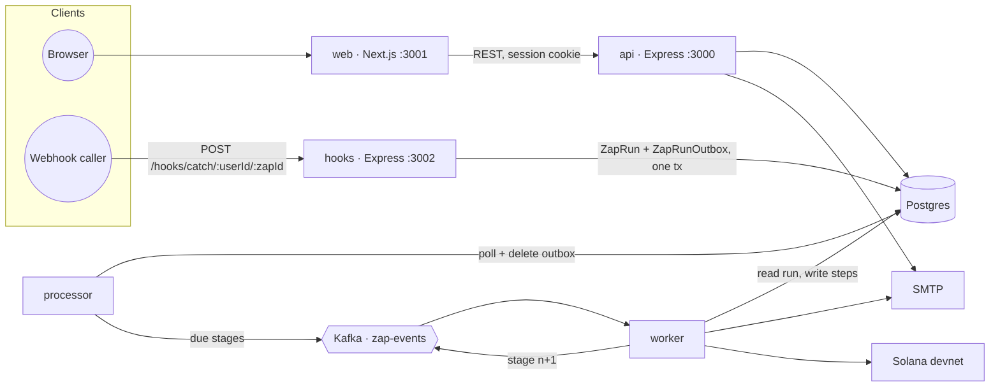
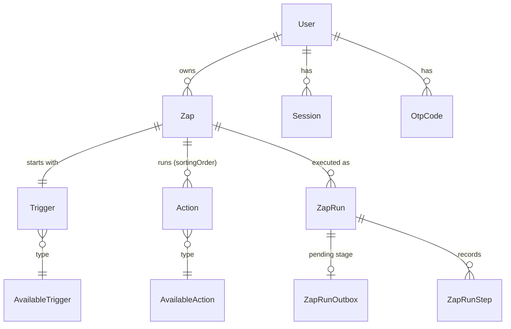
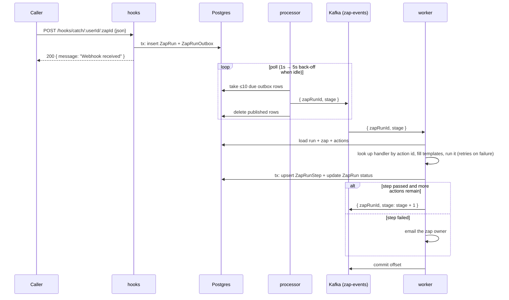

# Integrix architecture

This document explains how Integrix works end to end: the services, the data model, the life of a run, delivery guarantees, the connector model, and where the system is headed. For setup, see the [README](README.md). For file-level rules per module, see the [OKF index](okf/index.md). For the user-facing guide, see the in-app docs at `/docs`.

## 1. What Integrix does

A user builds a **zap**: one trigger (today, a webhook) followed by an ordered list of **actions** (Email, Solana). Every JSON `POST` to the zap's URL creates a **run**. The run's actions execute in order in the background, and `{placeholders}` in each action's settings are filled from the request body.

## 2. System overview

| Service             | Responsibility                                                                        | Talks to                   | State                         |
| ------------------- | ------------------------------------------------------------------------------------- | -------------------------- | ----------------------------- |
| `apps/web`          | UI: marketing site, docs, auth screens, zap builder and dashboard                     | api (browser `fetch`)      | none (cookie in browser)      |
| `apps/api`          | Auth (email OTP, Google OAuth, cookie sessions), profile, zap CRUD, connector catalog | Postgres, SMTP             | stateless                     |
| `apps/hooks`        | Public webhook intake; records a run and its outbox row atomically                    | Postgres                   | stateless                     |
| `apps/processor`    | Moves due outbox rows into Kafka (stage 0 for a new run)                              | Postgres, Kafka            | stateless (outbox is the log) |
| `apps/worker`       | Runs one action per message, records the step, queues the next stage, commits         | Postgres, Kafka, SMTP, RPC | Kafka consumer group offsets  |
| `packages/database` | Prisma schema, migrations, seed, shared client                                        | —                          | —                             |
| `packages/mailer`   | One SMTP transport shared by the API (OTP) and the worker (Email action, run alerts)  | SMTP                       | —                             |

Every backend service imports `@integrix/database`, so there is one schema and one client for the whole monorepo.

## 3. Data model

- **Catalog tables**: `AvailableTrigger` and `AvailableAction` list the connector types. Their string ids (`webhook`, `email`, `solana`) are the contract that every registry keys on. `seed.ts` upserts them idempotently.
- **Zap definition**: `Zap` (with an optional custom `name`), `Trigger` and `Action`. Deleting a zap cascades in the database to its trigger, actions, runs and pending outbox rows. A queued stage for a deleted zap finds no run, so the worker logs it and skips it. `Action.sortingOrder` (0-based) is the stage number, and `Action.metadata` is a flat map of template strings such as `{ "email": "{email}" }`.
- **Execution**: `ZapRun.metadata` holds the raw webhook body, and `status` (`queued`, `running`, `success`, `failed`, `halted`) with `createdAt` and `finishedAt` track its progress. Runs from before run history are `unknown`. `ZapRunStep` holds one row per stage (unique on run and stage): the connector id, `status` (`success`, `failed`, `halted`, `skipped`), `error`, `output` and timings. A `ZapRunOutbox` row is a stage waiting to be published: it carries its `stage` and an `availableAt` time, and exists only until the processor publishes it.
- **Auth**: `Session` and `OtpCode` store SHA-256 hashes only, never raw tokens or codes.

## 4. Life of a run

1. **Intake** (`hooks`): the body (100 KB max) becomes `ZapRun.metadata`. The run and outbox rows are written in one transaction, so an accepted request can't be lost and a failed write leaves nothing behind. The handler makes no external calls, which keeps it fast.
2. **Publish** (`processor`): it ensures the topic exists (1 partition, RF 1), then drains the outbox in batches, taking only rows whose `availableAt` has passed and publishing each at its own `stage`. Hooks writes stage 0 rows that are due at once; a later stage with a future `availableAt` is how a run can wait without the worker sleeping. When the outbox is empty, polling backs off exponentially to 5 s; after a full batch it polls again immediately.
3. **Execute** (`worker`, consumer group `main-worker`, manual commits): it finds the action whose `sortingOrder === stage` and resolves its handler from the registry. The worker fills the templates from the payload and awaits the handler, which may return `{ output?, halt? }`. It then writes the step's result and the run's new status in one transaction, publishes `stage + 1` straight to Kafka if the step passed and more actions remain, and only after that commits the offset. A step that returns `halt` ends the run as `halted` without an error.

Each stage is its own Kafka message, so a failing step is retried alone and earlier steps aren't repeated. Database or Kafka errors (as opposed to a failing action) still throw, and Kafka redelivers the message once the outage clears.

## 5. Delivery guarantees and failure modes

| Situation                                       | Behavior                                                                                                                                                                                                                                           |
| ----------------------------------------------- | -------------------------------------------------------------------------------------------------------------------------------------------------------------------------------------------------------------------------------------------------- |
| DB write fails in hooks                         | The transaction rolls back and the caller gets a 500. Nothing is half-stored.                                                                                                                                                                      |
| Processor crashes between Kafka send and delete | Rows are re-published, so stage 0 can run twice (**at-least-once**).                                                                                                                                                                               |
| Handler throws                                  | The stage retries in place after 1 s, 5 s and 10 s. If it still fails, the step and run are marked `failed` with the error, later steps don't run, the zap's owner is emailed, and the offset is committed, so one bad step can't block the queue. |
| Worker crashes after the handler, before commit | The stage is redelivered. If its step was already recorded as `success` the handler is skipped and only the next stage is re-queued. Otherwise it runs again, so handlers should be idempotent.                                                    |
| Unknown action id (no handler registered)       | The worker logs a warning, records the step as `skipped` and continues to the next stage.                                                                                                                                                          |
| Failure email can't be sent                     | It's logged and dropped. The run is already marked `failed`, and the stage isn't redelivered.                                                                                                                                                      |
| Kafka unavailable                               | Runs accumulate safely in the outbox until the processor can publish.                                                                                                                                                                              |

Known gaps (candidates for future work): a failed run can't be replayed yet; runs and their steps are never pruned; and `userId` in the webhook URL isn't checked against the zap's owner.

## 6. Templating

`apps/worker/src/parser.ts` replaces `{path}` with values from the payload. Dotted paths (`{user.email}`) walk nested objects, and string fields holding JSON are parsed on the way. Objects and arrays are inserted as JSON, and unknown or malformed placeholders are left unchanged. The parser is pure and covered by `parser.test.ts`.

## 7. Connector model

A connector is identified by one string id. Each layer keeps its own small registry keyed by that id, so adding a connector extends registries and never adds `if (type === …)` branches:

| Layer  | Registry                                         | Holds                                                      |
| ------ | ------------------------------------------------ | ---------------------------------------------------------- |
| DB     | `packages/database/seed.ts`                      | Catalog row (id, name, image)                              |
| Worker | `apps/worker/src/actions/index.ts`               | `ActionHandler(metadata, payload)` → `{ output?, halt? }`  |
| Web    | `apps/web/components/zap/action-fields.ts`       | Builder form fields per action                             |
| Web    | `apps/web/components/zap/integration-catalog.ts` | Display name, kind and description                         |
| Web    | `apps/web/components/zap/integration-icon.tsx`   | Monochrome icon for built-ins                              |
| Web    | `apps/web/components/zap/zap-templates.ts`       | Sample zaps, shown on `/docs` and prefilled in the builder |

The step-by-step checklist lives in [okf/connectors.md](okf/connectors.md). `zap-templates.test.ts` fails if a sample uses an unknown connector or a field set that doesn't match the builder form.

### Toward user-configurable connectors (planned, not built)

The goal is to let users define and configure connectors without a code change. Today's seams are chosen so that change stays additive:

- **Definitions move to data.** Add a field schema (for example, a `fields` JSON column) to `AvailableAction` and `AvailableTrigger`, and serve it from `/action/available` and `/trigger/available`. The builder then renders from the server schema and keeps `action-fields.ts` and `integration-catalog.ts` as fallbacks for built-ins. Code that consumes connectors already goes through these id-keyed lookups, not concrete types.
- **Validation follows the schema.** The API validates `actionMetadata` against the connector's field schema with zod at the boundary, instead of today's flat string map.
- **Per-user credentials.** A `Connection` table (user, connector id, encrypted secret) replaces server-wide secrets such as `SMTP_*` and `SOL_PRIVATE_KEY`. Secrets are encrypted at rest and never sent back to the browser.
- **Handler context.** `ActionHandler` gains an optional context argument (for example, the resolved connection). Existing handlers ignore it, so they stay substitutable.
- **Generic HTTP action.** The first user-defined connector is likely a configurable HTTP request (method, URL, headers and body template). It reuses the parser and needs no new worker code per connector.

## 8. Authentication and security

- **Signup and login**: email and password, then a 6-digit email OTP (10 minutes, 5 attempts, 60 s resend cooldown). Google OAuth uses the authorization-code flow with a state cookie, and a verified provider email skips the OTP.
- **Sessions**: a random token in the httpOnly `integrix_session` cookie (7 days, `SameSite=Lax`, `Secure` on https). Only its hash is stored, and logout or a password change revokes sessions.
- **API**: credentialed CORS for `WEB_URL` only. Protected routes use `authMiddleware` and scope every query by `req.userId`. Bodies are validated with zod.
- **Webhooks** are unauthenticated by design: possession of the URL authorizes a run. Treat zap URLs as secrets.

## 9. Web app

- **Route groups**: `(marketing)` is public and holds the landing page and `/docs`, both static server components. `(auth)` holds login and signup. `(app)` holds the dashboard, integrations, settings and the zap builder and detail pages, behind `RequireAuth`. The zap page has Overview and History tabs; History lists the latest runs and their steps.
- **Data**: `lib/api.ts` is the only backend client. `useApi` handles GETs and `useSession` is the single session store.
- **Builder**: picks connectors through `StepPicker` and the `action-fields` registry, and publishes `POST /api/v1/zap`. `/zap/create?template=<id>` prefills it from `zap-templates.ts`.
- **Design system**: monochrome tokens in `globals.css` and primitives in `components/ui`. See [okf/design-system.md](okf/design-system.md).

## 10. Deployment and footprint

`docker-compose.yml` runs Postgres, single-node KRaft Kafka, a one-shot `migrate` job (migrations and seed), and the five apps. Memory limits total about 1.6 GB. Postgres is tuned down, Prisma pools are capped at 3 connections, images are multi-stage and non-root, and the web app runs as the Next standalone server. Locally, run only Postgres and Kafka in Docker and run the apps with `bun run dev`. Ports: web 3001, api 3000, hooks 3002, Postgres 5433, Kafka 9092.

**Scaling path**: `api` and `hooks` are stateless and scale horizontally. Worker throughput grows by adding `zap-events` partitions and worker replicas in the same consumer group. The processor stays a single instance unless the outbox read changes to row locking (`FOR UPDATE SKIP LOCKED`).

## 11. Where documentation lives

| Doc                                      | Audience                | Update when                                                           |
| ---------------------------------------- | ----------------------- | --------------------------------------------------------------------- |
| [README.md](README.md)                   | Anyone setting it up    | Setup, scripts, env vars, ports or the stack change                   |
| `ARCHITECTURE.md` (this file)            | Contributors            | Services, data flow, data model, guarantees or connector model change |
| [okf/](okf/index.md)                     | Contributors, AI agents | A module's documented contract changes (log it in `okf/log.md`)       |
| `apps/web/app/(marketing)/docs/page.tsx` | End users               | User-facing behavior, connectors, templating or the public API change |
