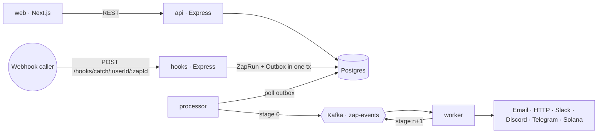

# Integrix

Integrix is a workflow automation platform in the spirit of Zapier. Create a zap with a webhook or schedule trigger and chain steps such as **email**, **HTTP requests**, **Slack, Discord and Telegram messages** and **Solana transfers**, with **filters** and **delays** in between. Every POST to the zap's URL, or every scheduled firing, runs those steps in order. Each run is recorded step by step, a failed run emails you and can be replayed, webhooks can require a signature, and you can connect your own Gmail account and Solana wallet. The platform is reliable by design (transactional outbox and Kafka) and sized to run cheaply on a single small host.

[](https://github.com/bixl007/Integrix/actions/workflows/ci.yml)

## Architecture



How a run flows:

1. A POST to a zap's URL reaches `hooks`, which checks the owner and, when the trigger has a secret, the sender's signature. It then writes a `ZapRun` (with a copy of the zap's steps) and a `ZapRunOutbox` row in one transaction, so an accepted event is never lost.
2. `processor` publishes due outbox rows to the Kafka topic `zap-events` (stage 0 for a new run, a later stage after a delay or a replay) and starts runs for scheduled zaps that are due.
3. `worker` runs that stage's action, with `{placeholders}` filled from the webhook body, records the step on the run, publishes stage + 1 and only then commits. Each step retries on its own, and delivery is at-least-once. Each zap's History tab shows its runs, and a failed run emails the zap's owner.

[ARCHITECTURE.md](ARCHITECTURE.md) covers the full design: the data model, the run lifecycle, failure modes, the connector model and the plan for user-configurable connectors.

| Workspace           | Role                                                                                              |
| ------------------- | ------------------------------------------------------------------------------------------------- |
| `apps/web`          | Next.js 15 frontend, Vercel-style design system                                                   |
| `apps/api`          | Auth (email OTP, Google OAuth, cookie sessions), zaps, run history and replay, connections, usage |
| `apps/hooks`        | Public webhook receiver; checks owner and signature, writes the run and outbox row                |
| `apps/processor`    | Publishes due outbox rows to Kafka with idle back-off and starts scheduled runs                   |
| `apps/worker`       | Executes one step per stage via a handler registry and records its result                         |
| `packages/database` | Prisma schema, migrations, built-in catalog, seed, shared client and helpers                      |
| `packages/mailer`   | Server SMTP sender (OTP, run alerts, Email steps) and per-user Gmail sending                      |
| `packages/tsconfig` | Shared TypeScript presets                                                                         |

## Documentation

| Where                                              | What                                                                                                                                  |
| -------------------------------------------------- | ------------------------------------------------------------------------------------------------------------------------------------- |
| [`/docs`](http://localhost:3001/docs) (in the app) | User guide: quick start, templating, connector reference, **sample integrations** you can add in one click, webhook and API reference |
| [ARCHITECTURE.md](ARCHITECTURE.md)                 | How the system works end to end                                                                                                       |
| [okf/](okf/index.md)                               | Per-module guides for contributors and AI agents, plus the [connectors checklist](okf/connectors.md)                                  |

## Tech stack

Bun 1.4 (package manager) · Node.js 26 (runtime) · Turborepo · TypeScript · Next.js 15 + React 19 · Tailwind CSS v4 · Express 5 · Prisma + PostgreSQL · Kafka (KRaft) · Docker Compose · ESLint, Prettier, Husky and lint-staged · GitHub Actions.

## Quick start (Docker)

```bash
git clone https://github.com/bixl007/Integrix.git
cd Integrix
cp .env.example .env   # add SMTP (Gmail) so OTP emails can be sent
docker compose up --build -d
```

Open http://localhost:3001. A one-shot `migrate` container applies migrations and seeds the built-in trigger and actions before the services start.

```bash
docker compose ps        # status
docker compose logs -f worker
docker compose down      # stop
```

## Local development

Requirements: **Node 26** (`nvm use`), **Bun ≥ 1.4**, and Postgres and Kafka. The simplest setup runs only the infrastructure in Docker:

```bash
bun install
cp .env.example .env
docker compose up -d postgres kafka
bun run db:migrate
bun run dev              # seeds, then runs every app in watch mode
```

| Service  | URL                   |
| -------- | --------------------- |
| Web      | http://localhost:3001 |
| API      | http://localhost:3000 |
| Hooks    | http://localhost:3002 |
| Postgres | `localhost:5433`      |
| Kafka    | `localhost:9092`      |

### Scripts

| Command                     | What it does                                         |
| --------------------------- | ---------------------------------------------------- |
| `bun run dev`               | Seed the database, then start all apps in watch mode |
| `bun run build`             | Build every workspace (Turbo-cached)                 |
| `bun run check`             | Lint, format check, typecheck and tests              |
| `bun run lint` / `lint:fix` | ESLint across the monorepo                           |
| `bun run format`            | Prettier write                                       |
| `bun run typecheck`         | `tsc --noEmit` in every workspace                    |
| `bun run test`              | Bun test runner                                      |
| `bun run db:migrate`        | Apply Prisma migrations                              |
| `bun run db:seed`           | Upsert built-in triggers and actions                 |
| `bun run db:studio`         | Open Prisma Studio                                   |
| `bun run docker:build`      | Build and start the full stack in Docker             |

A Husky pre-commit hook runs ESLint and Prettier on staged files, and CI runs `check` plus `build` on every PR.

## Environment variables

All apps read the root `.env`. See [`.env.example`](.env.example) for the full list.

| Variable                                       | Used by           | Notes                                                                                                                               |
| ---------------------------------------------- | ----------------- | ----------------------------------------------------------------------------------------------------------------------------------- |
| `DATABASE_URL`                                 | all services      | Compose overrides it with its internal host                                                                                         |
| `KAFKA_BROKER`                                 | processor, worker | `localhost:9092` locally                                                                                                            |
| `WEB_URL`, `API_PUBLIC_URL`                    | api, worker       | CORS origin, OAuth callback base, `Secure` cookies when https. The worker uses `WEB_URL` for the history link in run-failure emails |
| `GOOGLE_CLIENT_ID`, `GOOGLE_CLIENT_SECRET`     | api               | Optional Google sign-in                                                                                                             |
| `NEXT_PUBLIC_API_URL`, `NEXT_PUBLIC_HOOKS_URL` | web               | Inlined at build time                                                                                                               |
| `SOL_PRIVATE_KEY`                              | worker            | Base58 secret key of a funded devnet wallet, used by Solana steps without their own connection                                      |
| `CONNECTION_SECRET`                            | api, worker       | Encrypts users' saved connections. Generate with `openssl rand -hex 32`; without it connections can't be added or used              |
| `SMTP_*`, `FROM_EMAIL`                         | api, worker       | For Gmail, use an App Password                                                                                                      |

## Resource footprint

The stack targets a low-traffic personal deployment:

- **Kafka** runs in single-node KRaft mode (no Zookeeper) with a 256 MB heap and a cheap port healthcheck.
- **Postgres** is tuned down (`shared_buffers=32MB`, `max_connections=30`), and each service's Prisma pool is capped at 3 connections.
- **Images** are multi-stage, production-only and non-root on `node:26-alpine`. The web image is the Next standalone server rather than `next dev`.
- **Memory limits** apply to every container (about 1.6 GB total), with log rotation enabled.
- The **processor** backs off to a 5 s poll when the outbox is idle.
- The **frontend** is a static landing page with no animation or icon libraries, self-hosted Geist fonts, and CSS-only motion.

## Authentication

- **Email and password with OTP**: signup and login both email a 6-digit code (valid for 10 minutes, 5 attempts, resend after 60s). The session only starts after the code is verified.
- **Google sign-in (optional)**: create an OAuth client in Google Cloud Console (type _Web application_). Add the redirect URI `http://localhost:3000/api/v1/auth/oauth/google/callback`, put the ID and secret in `.env`, and restart the API.
- **Sessions**: a random token in an httpOnly cookie (`SameSite=Lax`) that lasts 7 days. Only its hash is stored in Postgres, and logout revokes it.

## Using the API

<details>
<summary>Sign up, create a zap and trigger it with curl</summary>

```bash
# 1) Sign up: emails a 6-digit code (printed in the API logs when SMTP is unset)
curl -X POST http://localhost:3000/api/v1/user/signup \
  -H "Content-Type: application/json" \
  -d '{"username":"demo@example.com","password":"password123","name":"Demo User"}'

# 1b) Verify the code: sets the 7-day session cookie
curl -c cookies.txt -X POST http://localhost:3000/api/v1/user/verify-otp \
  -H "Content-Type: application/json" \
  -d '{"username":"demo@example.com","code":"123456"}'

# 2) List built-ins (triggers: webhook, schedule | actions: email, http, slack, discord, telegram, filter, delay, solana)
curl http://localhost:3000/api/v1/trigger/available
curl http://localhost:3000/api/v1/action/available

# 3) Create a zap: Webhook → Solana → Email
curl -X POST http://localhost:3000/api/v1/zap \
  -H "Content-Type: application/json" \
  -b cookies.txt \
  -d '{
    "name": "SOL payout with receipt",
    "availableTriggerId": "webhook",
    "triggerMetadata": {},
    "actions": [
      { "availableActionId": "solana", "actionMetadata": { "amount": "{amount}", "address": "{address}" } },
      { "availableActionId": "email",  "actionMetadata": { "email": "{email}", "subject": "You received {amount} SOL", "body": "Hi {name},\n\nWe sent {amount} SOL to your wallet." } }
    ]
  }'

# 4) Fire the webhook
curl -X POST http://localhost:3002/hooks/catch/1/YOUR_ZAP_ID \
  -H "Content-Type: application/json" \
  -d '{"name":"Sunny","email":"receiver@example.com","amount":"0.1","address":"G4wJLrP971arCEKvcCJnW6K2932GRtAeHtKRMYSZsSja"}'

# 5) See how the run went, step by step
curl -b cookies.txt http://localhost:3000/api/v1/zap/YOUR_ZAP_ID/runs
```

</details>

Action metadata values are templates. `{field}` and `{nested.field}` resolve against the webhook body, `{steps.N.field}` reads the output of an earlier step, and unknown placeholders are left unchanged. Ready-made zaps (welcome email, GitHub star alert, order confirmation, big-order filter, delayed follow-up, Slack, Discord and Telegram alerts, forwarding to your API, SOL payout with receipt) are on the in-app [docs page](http://localhost:3001/docs#sample-integrations). Each has a one-click **Use template** button and its API body.

## Project structure

```text
.
├── apps/
│   ├── web/                # app/ (route groups, (marketing)/docs), components/ui (design system), lib/, hooks/
│   ├── api/                # src/{routes,middleware,schemas,db}
│   ├── hooks/              # src/signatures (webhook signature checks)
│   ├── processor/
│   └── worker/             # src/actions (handler registry), parser, guarded http client
├── packages/
│   ├── database/           # schema.prisma, migrations/, src/catalog.ts (built-ins), seed.ts
│   ├── mailer/             # server SMTP sender and per-user Gmail sending
│   └── tsconfig/
├── docker/                 # service.Dockerfile, web.Dockerfile
├── okf/                    # module guides for humans and AI agents
├── .github/workflows/      # CI
├── ARCHITECTURE.md         # how the system works
├── CLAUDE.md · AGENTS.md · REVIEW.md
└── docker-compose.yml
```

## Contributing (humans and AI agents)

Read [CLAUDE.md](CLAUDE.md) for conventions (SOLID, LLD and short comments), the [OKF index](okf/index.md) for the module you're touching, and [REVIEW.md](REVIEW.md) before opening a PR. Run `bun run check && bun run build` locally.

Docs ship with the code. A feature or behavior change updates the affected `okf/` guide (plus an `okf/log.md` entry), the `/docs` page if users see it, `ARCHITECTURE.md` if the architecture changes, and this README if setup or informational content changes. To add a trigger or action, follow [okf/connectors.md](okf/connectors.md).

## Troubleshooting

- **A run failed**: open the zap's History tab for the failing step and its error, fix the cause, then use Replay from failed step.
- **Webhook answers 401, 403 or 404**: 401 is a wrong or missing signature for a trigger that has a secret, 403 is a zap that is turned off, and 404 is an unknown zap, a wrong user id in the URL or a scheduled zap.
- **"Connections are not set up on this server"**: set `CONNECTION_SECRET` (`openssl rand -hex 32`) and restart `api` and `worker`.
- **An HTTP step is refused as a private or internal address**: steps can only call public hosts, not localhost or your own network.
- **`insufficient lamports`**: fund the devnet wallet the step pays from (its connection, or `SOL_PRIVATE_KEY`) or lower `amount`.
- **Email not sending**: check the `SMTP_*` values. For Gmail, use an App Password and make `FROM_EMAIL` match the account.
- **No OTP email arrives**: check the `SMTP_*` values and your spam folder. Locally without SMTP, the code is printed in the API logs.
- **Google button missing**: set both `GOOGLE_CLIENT_ID` and `GOOGLE_CLIENT_SECRET`, then restart the API.
- **Stale env in containers**: run `docker compose up --build -d`.
