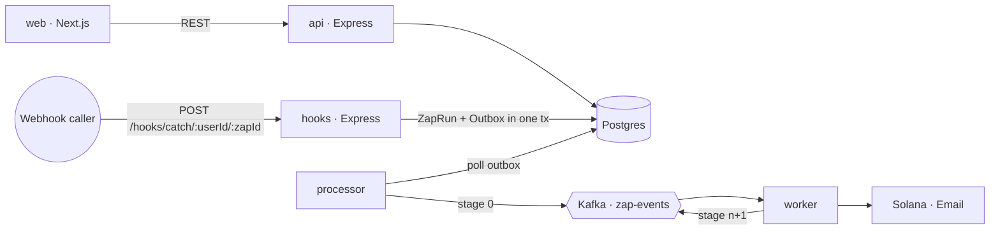

# Integrix

Integrix is a webhook-driven workflow automation platform in the spirit of Zapier. Create a zap with a webhook trigger, chain actions such as **Solana transfers** and **email**, and every POST to the zap's URL runs those actions in order. The platform is reliable by design (transactional outbox and Kafka) and sized to run cheaply on a single small host.

[](https://github.com/bixl007/Integrix/actions/workflows/ci.yml)

## Architecture



| Workspace           | Role                                                               |
| ------------------- | ------------------------------------------------------------------ |
| `apps/web`          | Next.js 15 frontend, Vercel-style design system                    |
| `apps/api`          | Auth (email OTP, Google OAuth, cookie sessions) and zap management |
| `apps/hooks`        | Public webhook receiver; writes the run and outbox row             |
| `apps/processor`    | Publishes outbox rows to Kafka with idle back-off                  |
| `apps/worker`       | Executes one action per stage via a handler registry               |
| `packages/database` | Prisma schema, migrations, seed and shared client                  |
| `packages/tsconfig` | Shared TypeScript presets                                          |

## Tech stack

Bun 1.4 (package manager) · Node.js 26 (runtime) · Turborepo · TypeScript · Next.js 15 + React 19 · Tailwind CSS v4 · Express 5 · Prisma + PostgreSQL · Kafka (KRaft) · Docker Compose · ESLint, Prettier, Husky and lint-staged · GitHub Actions.

## Quick start (Docker)

```bash
git clone https://github.com/bixl007/Integrix.git
cd Integrix
cp .env.example .env   # add SMTP (Gmail) so OTP emails can be sent
docker compose up --build -d
```

Open http://localhost:3001. A one-shot `migrate` container applies migrations and seeds the built-in trigger and actions before the services start.

```bash
docker compose ps        # status
docker compose logs -f worker
docker compose down      # stop
```

## Local development

Requirements: **Node 26** (`nvm use`), **Bun ≥ 1.4**, and Postgres and Kafka. The simplest setup runs only the infrastructure in Docker:

```bash
bun install
cp .env.example .env
docker compose up -d postgres kafka
bun run db:migrate
bun run dev              # seeds, then runs every app in watch mode
```

| Service  | URL                   |
| -------- | --------------------- |
| Web      | http://localhost:3001 |
| API      | http://localhost:3000 |
| Hooks    | http://localhost:3002 |
| Postgres | `localhost:5433`      |
| Kafka    | `localhost:9092`      |

### Scripts

| Command                     | What it does                                         |
| --------------------------- | ---------------------------------------------------- |
| `bun run dev`               | Seed the database, then start all apps in watch mode |
| `bun run build`             | Build every workspace (Turbo-cached)                 |
| `bun run check`             | Lint, format check, typecheck and tests              |
| `bun run lint` / `lint:fix` | ESLint across the monorepo                           |
| `bun run format`            | Prettier write                                       |
| `bun run typecheck`         | `tsc --noEmit` in every workspace                    |
| `bun run test`              | Bun test runner                                      |
| `bun run db:migrate`        | Apply Prisma migrations                              |
| `bun run db:seed`           | Upsert built-in triggers and actions                 |
| `bun run db:studio`         | Open Prisma Studio                                   |
| `bun run docker:build`      | Build and start the full stack in Docker             |

A Husky pre-commit hook runs ESLint and Prettier on staged files, and CI runs `check` plus `build` on every PR.

## Environment variables

All apps read the root `.env`. See [`.env.example`](.env.example) for the full list.

| Variable                                       | Used by           | Notes                                                         |
| ---------------------------------------------- | ----------------- | ------------------------------------------------------------- |
| `DATABASE_URL`                                 | all services      | Compose overrides it with its internal host                   |
| `KAFKA_BROKER`                                 | processor, worker | `localhost:9092` locally                                      |
| `WEB_URL`, `API_PUBLIC_URL`                    | api               | CORS origin, OAuth callback base, `Secure` cookies when https |
| `GOOGLE_CLIENT_ID`, `GOOGLE_CLIENT_SECRET`     | api               | Optional Google sign-in                                       |
| `NEXT_PUBLIC_API_URL`, `NEXT_PUBLIC_HOOKS_URL` | web               | Inlined at build time                                         |
| `SOL_PRIVATE_KEY`                              | worker            | Base58 secret key of a funded devnet wallet                   |
| `SMTP_*`, `FROM_EMAIL`                         | api, worker       | For Gmail, use an App Password                                |

## Resource footprint

The stack targets a low-traffic personal deployment:

- **Kafka** runs in single-node KRaft mode (no Zookeeper) with a 256 MB heap and a cheap port healthcheck.
- **Postgres** is tuned down (`shared_buffers=32MB`, `max_connections=30`), and each service's Prisma pool is capped at 3 connections.
- **Images** are multi-stage, production-only and non-root on `node:26-alpine`. The web image is the Next standalone server rather than `next dev`.
- **Memory limits** apply to every container (about 1.6 GB total), with log rotation enabled.
- The **processor** backs off to a 5 s poll when the outbox is idle.
- The **frontend** is a static landing page with no animation or icon libraries, self-hosted Geist fonts, and CSS-only motion.

## Authentication

- **Email and password with OTP**: signup and login both email a 6-digit code (valid for 10 minutes, 5 attempts, resend after 60s). The session only starts after the code is verified.
- **Google sign-in (optional)**: create an OAuth client in Google Cloud Console (type _Web application_). Add the redirect URI `http://localhost:3000/api/v1/auth/oauth/google/callback`, put the ID and secret in `.env`, and restart the API.
- **Sessions**: a random token in an httpOnly cookie (`SameSite=Lax`) that lasts 7 days. Only its hash is stored in Postgres, and logout revokes it.

## Using the API

<details>
<summary>Sign up, create a zap and trigger it with curl</summary>

```bash
# 1) Sign up: emails a 6-digit code (printed in the API logs when SMTP is unset)
curl -X POST http://localhost:3000/api/v1/user/signup \
  -H "Content-Type: application/json" \
  -d '{"username":"demo@example.com","password":"password123","name":"Demo User"}'

# 1b) Verify the code: sets the 7-day session cookie
curl -c cookies.txt -X POST http://localhost:3000/api/v1/user/verify-otp \
  -H "Content-Type: application/json" \
  -d '{"username":"demo@example.com","code":"123456"}'

# 2) List built-ins (ids: webhook | solana, email)
curl http://localhost:3000/api/v1/trigger/available
curl http://localhost:3000/api/v1/action/available

# 3) Create a zap: Webhook → Solana → Email
curl -X POST http://localhost:3000/api/v1/zap \
  -H "Content-Type: application/json" \
  -b cookies.txt \
  -d '{
    "availableTriggerId": "webhook",
    "triggerMetadata": {},
    "actions": [
      { "availableActionId": "solana", "actionMetadata": { "amount": "{amount}", "address": "{address}" } },
      { "availableActionId": "email",  "actionMetadata": { "email": "{email}", "body": "Hi {name}, you received {amount} SOL" } }
    ]
  }'

# 4) Fire the webhook
curl -X POST http://localhost:3002/hooks/catch/1/YOUR_ZAP_ID \
  -H "Content-Type: application/json" \
  -d '{"name":"Sunny","email":"receiver@example.com","amount":"0.1","address":"G4wJLrP971arCEKvcCJnW6K2932GRtAeHtKRMYSZsSja"}'
```

</details>

Action metadata values are templates. `{field}` and `{nested.field}` resolve against the webhook body, and unknown placeholders are left unchanged.

## Project structure

```text
.
├── apps/
│   ├── web/                # app/ (route groups), components/ui (design system), lib/, hooks/
│   ├── api/                # src/{routes,middleware,schemas,db}
│   ├── hooks/
│   ├── processor/
│   └── worker/             # src/actions (handler registry), parser
├── packages/
│   ├── database/           # schema.prisma, migrations/, seed.ts, prisma.config.ts
│   └── tsconfig/
├── docker/                 # service.Dockerfile, web.Dockerfile
├── okf/                    # module guides for humans and AI agents
├── .github/workflows/      # CI
├── CLAUDE.md · AGENTS.md · REVIEW.md
└── docker-compose.yml
```

## Contributing (humans and AI agents)

Read [CLAUDE.md](CLAUDE.md) for conventions (SOLID, LLD and short comments), the [OKF index](okf/index.md) for the module you're touching, and [REVIEW.md](REVIEW.md) before opening a PR. Run `bun run check && bun run build` locally.

## Troubleshooting

- **`insufficient lamports`**: fund the devnet wallet behind `SOL_PRIVATE_KEY` or lower `amount`.
- **Email not sending**: check the `SMTP_*` values. For Gmail, use an App Password and make `FROM_EMAIL` match the account.
- **No OTP email arrives**: check the `SMTP_*` values and your spam folder. Locally without SMTP, the code is printed in the API logs.
- **Google button missing**: set both `GOOGLE_CLIENT_ID` and `GOOGLE_CLIENT_SECRET`, then restart the API.
- **Stale env in containers**: run `docker compose up --build -d`.
